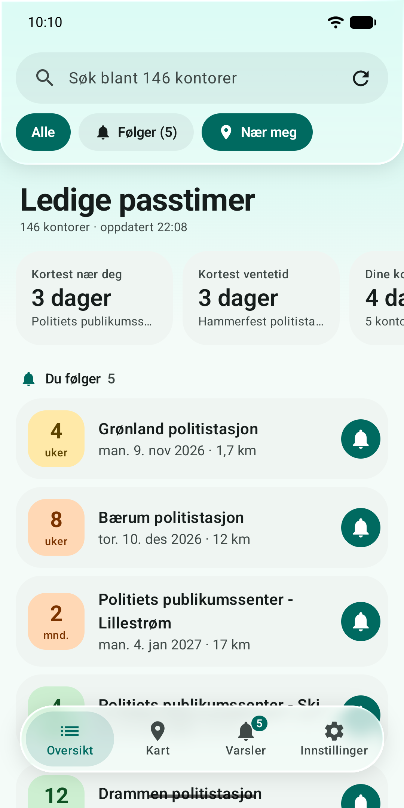
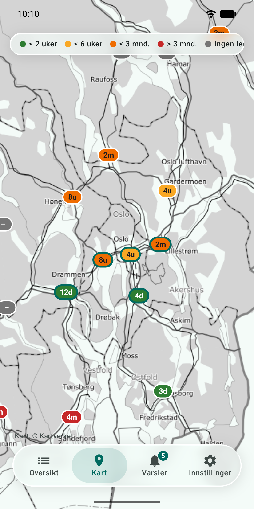
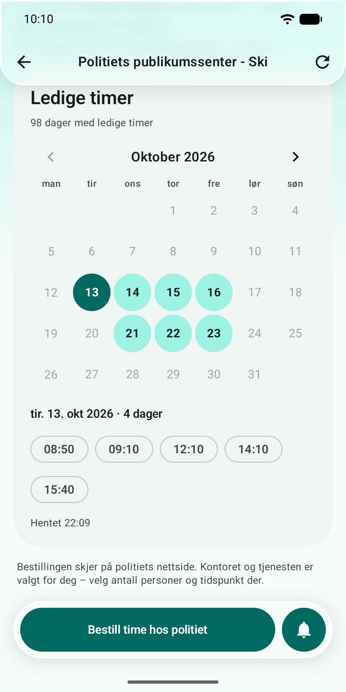
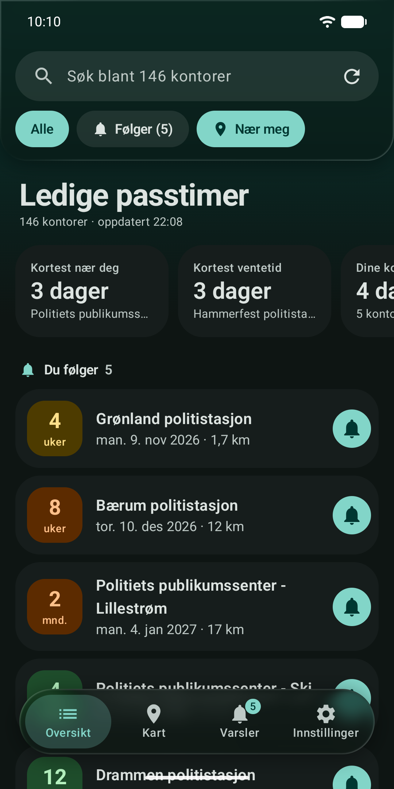

# Passradar

Gratis Android-app med åpen kildekode som sier fra når det blir ledig en **tidligere time for pass eller nasjonalt ID-kort** hos politiet.

Det er ofte fullbooket i uker og måneder, men avbestillinger skjer hele tiden. I stedet for å sjekke politiets nettside igjen og igjen, følger du kontorene du kan reise til, og får et varsel når en bedre time dukker opp.

*[English below](#english)*

<p>
  
  
  
  
</p>

## Bli tester på Google Play

Passradar er i lukket test på Google Play. For å slippe appen fri til alle krever Google minst 12 testere som har den i 14 dager. Har du en Android-telefon, hjelper du til slik:

1. Bli med i testgruppa: [groups.google.com/g/passradar-testere](https://groups.google.com/g/passradar-testere)
2. Åpne [play.google.com/apps/testing/io.github.passradar](https://play.google.com/apps/testing/io.github.passradar) og trykk «Become a tester»
3. Installer appen fra [Google Play](https://play.google.com/store/apps/details?id=io.github.passradar), og behold den i minst 14 dager

Bruk samme Google-konto som på telefonen. Butikklenken virker først når du har blitt tester. Feil og ønsker tas imot som [saker (issues)](../../issues).

## Funksjoner

- **Varsel** når det blir ledig en tidligere time ved kontorene du følger – følg så mange du vil
- Velg hva som er verdt et varsel: alle tidligere timer, timer innen et antall uker, eller timer før en bestemt dato
- **Ventetid** for hvert kontor, med kontorene du følger øverst og resten sortert etter avstand fra deg («Nær meg» er standard)
- **Kart** med fargekoder for ventetid (kartdata fra Kartverket), også i mørk utgave
- **Kalender** med ledige datoer og klokkeslett for hvert kontor
- **Direktelenke** til politiets timebestilling med kontor og tjeneste ferdig valgt
- Alle tjenestene i timebestillingen (pass/ID-kort, hente ferdig pass, ID-kort for EU/EØS-borgere osv.), for 1–9 personer
- **Lyst og mørkt tema**, Material 3 med «liquid glass» (uskarpt glass på Android 12+, ugjennomsiktig på eldre)
- Hjelp til å slå av **batterioptimalisering og strømsparing**, med lenker rett til riktig innstilling – også Samsungs «apper i hvilemodus» og tilsvarende hos andre produsenter
- Virker på **Android 5.0 og nyere**, testet på Android 5 og Android 17
- Norsk og engelsk: følger språket på telefonen, eller velg selv under *Innstillinger*

## Slik virker det

Politiets timebestilling på [pass-og-id.politiet.no](https://pass-og-id.politiet.no/timebestilling/index.html) henter ledige timer fra et åpent grensesnitt. Appen spør det samme grensesnittet, på samme måte som nettsiden gjør når du klikker deg fram til et kontor.

Det finnes **ingen server**: telefonen din sjekker selv, så tjenesten koster ingenting å drive. Av hensyn til politiets system:

- sjekker appen i bakgrunnen bare kontorene du følger, og aldri oftere enn hvert 15. minutt
- henter den oversikten over alle kontorer rolig, to og to, og høyst én gang i timen av seg selv
- sier den ærlig hvem den er (`User-Agent: Passradar/…`)
- bestiller den aldri noe for deg: du bestiller selv på politiets side

Appen er laget fra bunnen av ut fra politiets offentlige nettside, og bygger ikke på koden til andre apper.

## Kjente begrensninger

- Android kan utsette eller stoppe bakgrunnssjekker for å spare strøm. Appen spør én gang om å få kjøre i bakgrunnen, og kortet «Sørg for at varslene kommer fram» (under *Varsler* og *Innstillinger*) viser hva som eventuelt mangler.
- Appen sjekker høyst hvert 15. minutt, så en avbestilt time kan bli tatt av noen andre før du rekker den.
- Grensesnittet appen leser fra er offentlig, men ikke en dokumentert tjeneste fra politiet. Endrer politiet timebestillingen, må appen oppdateres.
- Politiets timebestilling svarer bare på forbindelser fra Norge. I utlandet viser appen kontorene og kartet, men ingen ledige timer.

## Personvern

Ingen konto, ingen sporing, ingen reklame, ingen analyse. Appen kontakter bare `pass-og-id.politiet.no` (ledige timer) og `cache.kartverket.no` (kart). Det du følger, innstillingene dine og eventuell omtrentlig posisjon (avrundet, bare brukt til avstander) ligger bare på telefonen. Se [personvernerklæringen](PRIVACY.md).

## Installere

Bli tester på Google Play (se [over](#bli-tester-på-google-play)), eller last ned APK-filen fra [Releases](../../releases) og åpne den på telefonen. Da må du tillate installasjon fra ukjente kilder for nettleseren eller filbehandleren du bruker. Versjonene fra Google Play og GitHub er signert ulikt, så bytter du kilde, må du avinstallere først.

Etter installasjonen:

1. Tillat posisjon om du vil ha kontorene nær deg først (valgfritt).
2. Følg kontorene du kan reise til, og tillat varsler når appen spør.
3. Svar ja når appen ber om å få kjøre i bakgrunnen. På Samsung, Xiaomi og lignende: følg også rådet i kortet «Sørg for at varslene kommer fram».

## Bygge selv

Krever JDK 17 eller nyere og Android SDK, eller bare [Android Studio](https://developer.android.com/studio).

```bash
./gradlew assembleDebug            # app/build/outputs/apk/debug/
./gradlew testDebugUnitTest        # enhetstester
./gradlew assembleRelease          # optimalisert APK
./gradlew bundleRelease -Pplay     # app-pakke til Google Play
```

Uten signeringsnøkkel blir release-APK-en signert med debug-nøkkelen, så den kan installeres for testing. Hvordan du lager en ekte nøkkel og publiserer, står i [PUBLISHING.md](PUBLISHING.md).

### Teste varsler

Debug-bygget har en mottaker som later som den tidligste ledige datoen ved hvert kontor du følger nettopp ble ledig, og kjører en sjekk:

```bash
adb shell am broadcast -n io.github.passradar.debug/io.github.passradar.DebugReceiver
```

Varsellogikken er også dekket av enhetstester i `app/src/test`.

## Prosjektstruktur

| Sti | Innhold |
| --- | --- |
| `app/src/main/java/io/github/passradar/data/` | Politiets API, lagring og logikk |
| `app/src/main/java/io/github/passradar/domain/` | Når skal brukeren varsles? (`WatchEvaluator`), ventetid og søk |
| `app/src/main/java/io/github/passradar/work/` | Bakgrunnssjekk med WorkManager |
| `app/src/main/java/io/github/passradar/ui/` | Skjermene (Jetpack Compose); `ui/glass/` er glass-effekten |
| `app/src/main/assets/offices.json` | Kontorliste med kartposisjoner |
| `app/src/play/AndroidManifest.xml` | Det som skiller Google Play-bygget fra de andre |
| `fastlane/metadata/android/` | Butikktekster, ikon, funksjonsgrafikk og skjermbilder |
| `tools/update_offices.py` | Oppdaterer kontorlisten (politiet + Kartverkets adresse-API) |
| `tools/make_icons.py` | Tegner PNG-ikonene for gamle Android-versjoner |
| `tools/make_feature_graphic.ps1` | Tegner funksjonsgrafikken til Google Play |

### Vedlikehold

- **Nye eller nedlagte kontorer:** kjør `python tools/update_offices.py`. Appen henter også kontorlisten selv én gang i uka, men trenger fila for kartposisjoner.
- **Bibliotekversjoner:** AndroidX-bibliotekene er låst til de siste versjonene som støtter Android 5.0 (se kommentaren i `gradle/libs.versions.toml`). Nyere versjoner krever Android 6 eller 7.
- **Gamle telefoner:** Android 7.1 og eldre stoler ikke på rotsertifikatene til politiets server og Kartverket. Appen har dem med (`res/raw`) og bruker dem bare der (`net/LegacyTls.kt`).
- **Kildekodelenke i appen:** sett `passradar.sourceUrl` i `gradle.properties`.

## Ansvarsfraskrivelse

Passradar er uavhengig og ikke tilknyttet eller godkjent av Politiet. Data kommer fra politiets offentlige timebestilling og kan være forsinket eller feil. Det er ingen garanti for at du får time. Timen bestiller du alltid selv hos politiet.

## Lisens

[GNU General Public License v3.0 eller nyere](LICENSE). Du kan bruke, endre og dele appen fritt, men endrede versjoner som deles, må også ha åpen kildekode under samme lisens.

---

## English

**Passradar** is a free, open-source Android app that notifies you when an **earlier appointment for a Norwegian passport or national ID card** becomes available at a police office.

- Alerts when an earlier slot appears at any of the offices you follow – any earlier slot, slots within a number of weeks, or slots before a date you choose
- Waiting time for every office, with followed offices first and the rest sorted by distance ("Near me" by default)
- Colour-coded map, calendar of free dates and times, and a link to the police's booking page with office and service preselected
- Light and dark theme, Material 3 with a "liquid glass" look
- Norwegian and English: follows the phone's language, or pick one in Settings
- Helps you turn off battery optimisation, Battery Saver and vendor app killers so alerts arrive on time
- Android 5.0+, no server, no tracking. Your phone checks the police's public booking API itself, at most every 15 minutes and only for offices you follow. See the [privacy policy](PRIVACY.md).

**Help test it on Google Play:** join [the testers group](https://groups.google.com/g/passradar-testere), opt in at [play.google.com/apps/testing/io.github.passradar](https://play.google.com/apps/testing/io.github.passradar), then install it from [Google Play](https://play.google.com/store/apps/details?id=io.github.passradar) and keep it for at least 14 days. The police's booking service only answers from Norwegian networks.

Build with `./gradlew assembleDebug`; see [PUBLISHING.md](PUBLISHING.md) (Norwegian) for releases. Licensed under GPL-3.0-or-later. Not affiliated with the Norwegian Police.
